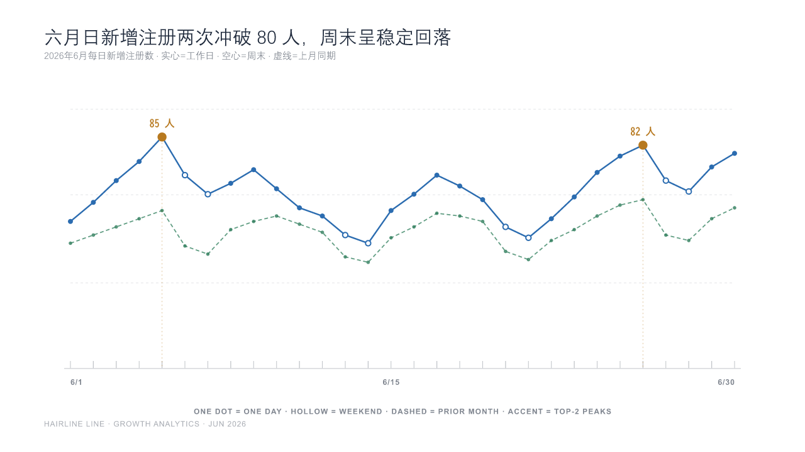
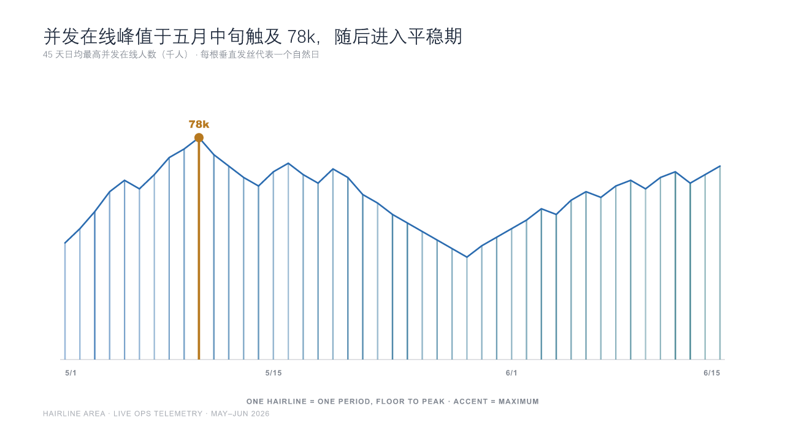
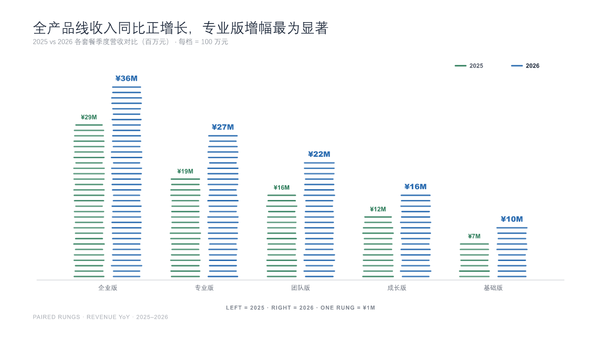
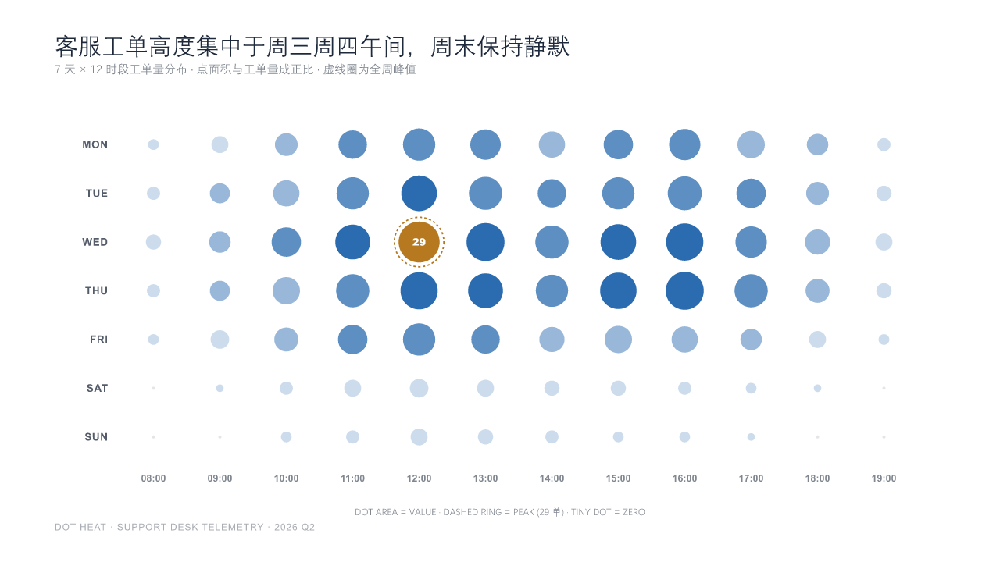
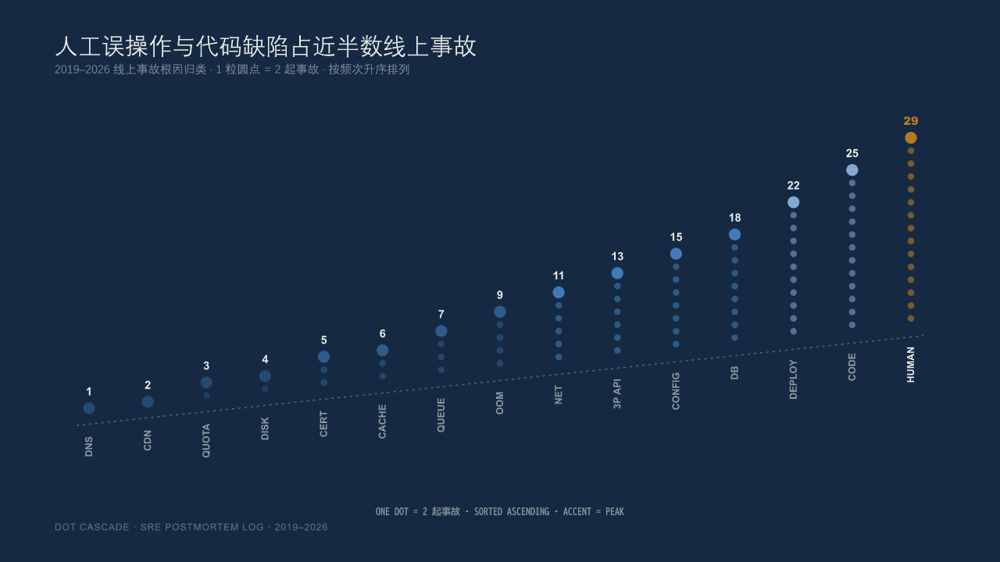
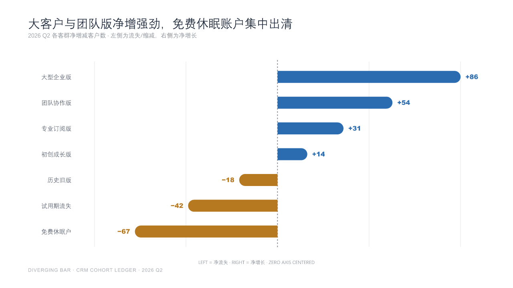

# Editorial PPTX Charts

一套独立、纯静态、自定义 2–3 主题色的编辑风格数据可视化引擎与 Agent Skill：沿用 [`lieflat-charts`](https://github.com/larashero3-dotcom/lieflat-charts) 的设计美学与图型谱系，专为无缝整合 [`ppt-master`](https://github.com/hugohe3/ppt-master) 生成可编辑 `.pptx` 而打造。

> **Phase 1 已交付 12 款图表**，全部通过 `ppt-master` 官方 `svg_quality_checker.py`（12/12，0 error / 0 warning），并经 `svg_to_pptx.py` 编译为原生可编辑 DrawingML 形状。
> 演示文件：[`examples/demo/operating_review_phase1.pptx`](./examples/demo/operating_review_phase1.pptx)（12 页，每页图形与文字均可在 PowerPoint 中直接点选编辑）

## 预览

| | |
|---|---|
|  |  |
| **F1 `rung_bars`** — 可数横档柱 | **F5 `tick_rows`** — 刻度队列条形 |
|  |  |
| **F2 `hairline_line`** — 发丝折线 + 日历地板 | **F3 `hairline_area`** — 发丝面积 |
|  |  |
| **F4 `tick_donut`** — 100 刻度环形 | **F6 `paired_rungs`** — 双梯并肩对比 |
|  |  |
| **F7 `stacked_rungs`** — 呼吸堆叠横档 | **F12 `dumbbell_queue`** — 串珠哑铃 |
|  |  |
| **F10 `dot_heat`** — 面积编码点阵热力 | **L2 `dot_cascade`** — 升序点阵阶梯 |
|  |  |
| **G10 `diverging_bar`** — 正负双向胶囊 | **G4 `dot_waffle`** — 百点华夫占比 |

## 核心特点

- **彩色优先 · 自定义 2–3 主题色**：无需内置固定主题；传入任意 2–3 个 `#RRGGBB` 主题色，或直接用 `--from-ppt-master` 从 `ppt-master` 的 `design_spec.md` / `spec_lock.md` 自动读取模板配色，派生完整色阶与结构线并自动守护 WCAG 对比度。
- **100% 纯静态矢量 SVG**：零 JS、零 CSS `<style>`、零 `class`、零动效、零外部字体或 CDN，完全确定性输出。
- **双模原生兼容 `ppt-master`**：
  - `--mode slide`（`1280×720`）：严格通过 `ppt-master` 的 `svg_quality_checker.py`，经 `svg_to_pptx.py` 直接编译为**原生可编辑 PowerPoint DrawingML 形状与文本**。
  - `--mode card`（自定义尺寸 + `--bg transparent`）：作为独立矢量图放入 `ppt-master` 项目的 `images/`，嵌入任意多栏幻灯片版式。
- **分阶段演进**：当前完成 **Phase 1 核心高频 12 款图表**（详见 [`catalog.md`](./catalog.md)），后续按 Phase 2（Lupi Editorial 深度叙事）与 Phase 3（分布与流向补全）持续扩展。

## 快速开始

只需要 Python 3.10+（零第三方依赖即可生成与校验 SVG）。

### 1. 列出已支持图型

```bash
python scripts/render.py --list
```

### 2. 用自定义 2–3 主题色渲染单张图表

```bash
# 整页 1280x720（可直接交给 ppt-master 编译为原生 PPTX）
python scripts/render.py examples/phase1_specs/01_rung_bars.json \
  --colors "#051C2C,#2251FF,#E65100" \
  --bg "#FFFFFF" \
  --mode slide \
  -o examples/out/01_rung_bars.svg

# 透明底卡片模式（供 ppt-master 多栏页面作为矢量插图嵌入）
python scripts/render.py examples/phase1_specs/05_tick_donut.json \
  --colors "#0F766E,#D97706,#1E3A8A" \
  --bg transparent \
  --mode card --width 600 --height 440 \
  -o examples/out/05_tick_donut_card.svg
```

### 3. 直接读取 `ppt-master` 模板配色批量出图并导出可编辑 PPTX

```bash
python scripts/gallery.py \
  --specs-dir examples/phase1_specs \
  --out-dir examples/out/mckinsey \
  --from-ppt-master /path/to/ppt-master/skills/ppt-master/templates/brands/mckinsey/templates/design_spec.md \
  --ppt-master /path/to/ppt-master \
  --export-pptx examples/out/mckinsey_phase1_charts.pptx
```

## 目录结构

```text
editorial-pptx-charts/
├── SKILL.md                  # 独立 Agent Skill 规范（可安装至 ~/.claude/skills/ 等）
├── catalog.md                # 12 款 Phase 1 图型目录 + Phase 2/3 路线图
├── README.md                 # 项目说明
├── scripts/
│   ├── palette.py            # 2-3 自定义主题色引擎 + ppt-master 配色解析器
│   ├── svg_builder.py        # ppt-master 规范纯静态 SVG 构建器
│   ├── validator.py          # 内置 ppt-master SVG 合同校验器
│   ├── pptx_bridge.py        # 联动 ppt-master checker & svg_to_pptx 导出器
│   ├── render.py             # 单图 CLI
│   ├── gallery.py            # 批量生成 + HTML 预览 + 可选导出 PPTX
│   └── charts/               # Phase 1 12 款图表渲染模块
├── docs/previews/            # 12 张图表渲染预览图
└── examples/
    ├── phase1_specs/         # 12 款图表的标准 JSON 数据样例
    └── demo/                 # 由 ppt-master 编译出的原生可编辑演示 PPTX
```

## 作为 Agent Skill 安装

```bash
# Claude Code
git clone https://github.com/seva324/editorial-pptx-charts.git ~/.claude/skills/editorial-pptx-charts

# 或任意支持 SKILL.md 的 Agent 运行时
git clone https://github.com/seva324/editorial-pptx-charts.git ~/.agents/skills/editorial-pptx-charts
```

安装后 Agent 会依据 [`SKILL.md`](./SKILL.md) 自动选择图型、锁定 `ppt-master` 模板配色并调用 `scripts/render.py` 出图。

## 验证状态

| 检查项 | 结果 |
|---|---|
| 内置 `validator.py` 合同校验 | 12/12 PASS |
| `ppt-master` 官方 `svg_quality_checker.py` | 12/12 PASS（0 error / 0 warning） |
| `ppt-master` `svg_to_pptx.py` 原生编译 | 12 页，`skipped 0`，每页 3 个可编辑分组 |
| 透明底卡片模式（`--mode card --bg transparent`） | 12/12 PASS |

## 致谢

- 设计美学与图型谱系源自 [`lieflat-charts`](https://github.com/larashero3-dotcom/lieflat-charts)
- PPTX 编译与 SVG 合同校验依赖 [`ppt-master`](https://github.com/hugohe3/ppt-master)

## License

MIT

